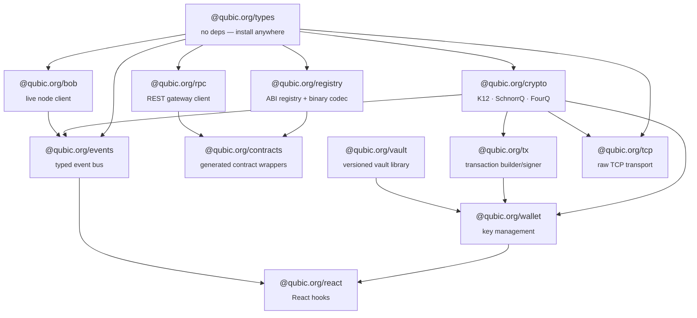
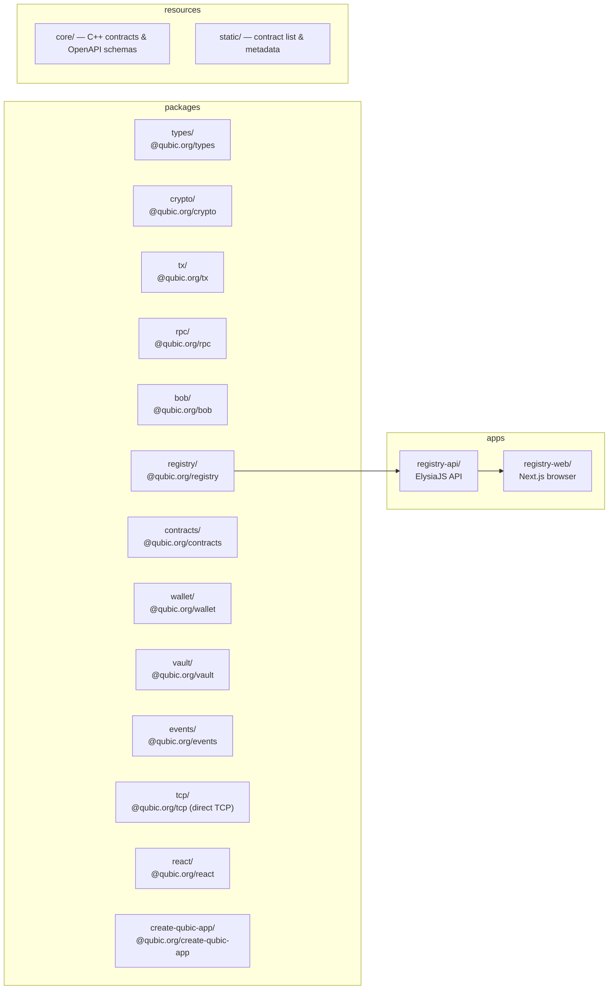

# qubic-typescript

TypeScript SDK for the [Qubic](https://qubic.org) network, split into focused packages for crypto, transaction building, RPC, ABI codec, and live node subscriptions. Built for [Bun](https://bun.com), works with Node.js.

> [!NOTE]
> **Public beta.** Core APIs are stable and the packages are in production use, but the public surface has not frozen yet. Breaking changes may land in minor versions before 1.0. Pin to an exact version and check the changelog when upgrading.

## Packages

| Package | Version | Description |
|---|---|---|
| [`@qubic.org/types`](packages/types) | [](https://www.npmjs.com/package/@qubic.org/types) | Branded primitives, protocol constants, shared error types |
| [`@qubic.org/crypto`](packages/crypto) | [](https://www.npmjs.com/package/@qubic.org/crypto) | K12 hash, SchnorrQ signatures, FourQ key derivation |
| [`@qubic.org/tx`](packages/tx) | [](https://www.npmjs.com/package/@qubic.org/tx) | Binary transaction builder, signer, and verifier |
| [`@qubic.org/rpc`](packages/rpc) | [](https://www.npmjs.com/package/@qubic.org/rpc) | Type-safe REST client for the Qubic RPC gateway |
| [`@qubic.org/bob`](packages/bob) | [](https://www.npmjs.com/package/@qubic.org/bob) | Live node client — JSON-RPC 2.0, REST, WebSocket subscriptions |
| [`@qubic.org/registry`](packages/registry) | [](https://www.npmjs.com/package/@qubic.org/registry) | Versioned ABI registry for all Qubic smart contracts across all epochs |
| [`@qubic.org/contracts`](packages/contracts) | [](https://www.npmjs.com/package/@qubic.org/contracts) | Generated typed wrappers for every deployed contract |
| [`@qubic.org/events`](packages/events) | [](https://www.npmjs.com/package/@qubic.org/events) | Binary event decoder, filter builder, and typed Bob subscription helpers |
| [`@qubic.org/wallet`](packages/wallet) | [](https://www.npmjs.com/package/@qubic.org/wallet) | Wallet, encrypted vault, and seed utilities |
| [`@qubic.org/vault`](packages/vault) | [](https://www.npmjs.com/package/@qubic.org/vault) | Versioned vault library — Argon2id, binary envelope, v1 migration |
| [`@qubic.org/tcp`](packages/tcp) | [](https://www.npmjs.com/package/@qubic.org/tcp) | Direct TCP transport — framing, connection pool, typed request helpers |
| [`@qubic.org/react`](packages/react) | [](https://www.npmjs.com/package/@qubic.org/react) | React hooks and providers — TanStack Query, VaultProvider, WalletProvider (extension / WalletConnect), contract queries, send mutations |
| [`@qubic.org/create-qubic-app`](packages/create-qubic-app) | [](https://www.npmjs.com/package/@qubic.org/create-qubic-app) | Interactive project scaffolder for Node/Bun scripts, Vite React dApps, Next.js dApps, and optional Biome/ESLint/Prettier setup |

## Quick start

```bash
bun install
bun test          # run all tests
bun run typecheck # typecheck all packages
bun run build     # build all packages
bun run lint      # lint + format (biome)
```

## Package dependency graph



## End-to-end example: wallet transfer

```ts
import { generateSeed, createWallet, createVault, unlockVault } from '@qubic.org/wallet'
import { createLiveClient } from '@qubic.org/rpc'

const live = createLiveClient()
const tickInfoResult = await live.getTickInfo()
if (!tickInfoResult.ok) throw tickInfoResult.error
const tickInfo = tickInfoResult.value

// Generate and persist a seed in an encrypted vault
const seed = generateSeed()
const vault = await createVault('strong-password', [seed])
// exportVault(vault) → persist JSON to disk / localStorage

// Later: unlock and use
const [storedSeed] = await unlockVault(vault, 'strong-password')
const wallet = createWallet(storedSeed)

console.log(wallet.identity) // 60-char Qubic identity

const { encoded } = await wallet.buildTransaction({
  destination: 'BZBQFLLBNCXEMGLOBHUVFTLUPLVCPQUASSILFABOFFBCADQSSUPNWLZBQEXK',
  amount: 1_000_000n,
  targetTick: tickInfo.tick + 5,
  currentTick: tickInfo.tick,
})

const result = await live.broadcastTransaction(encoded)
if (!result.ok) throw result.error
console.log('peers:', result.value.peersBroadcastedTo)
```

## End-to-end example: vault management

```ts
import { VaultManager, TaintStatusEnum } from '@qubic.org/vault'
import { deriveIdentityFromSeed } from '@qubic.org/crypto'

const vault = new VaultManager()

// Create vault with multiple seeds
const encrypted = await vault.create({
  seeds: [
    {
      publicId: deriveIdentityFromSeed('seed-one'),
      encryptedSeed: new TextEncoder().encode('seed-one'),
      alias: 'Main account',
      taintStatus: TaintStatusEnum.UNTAINTED,
    },
    {
      publicId: deriveIdentityFromSeed('seed-two'),
      encryptedSeed: new TextEncoder().encode('seed-two'),
      alias: 'Secondary account',
      taintStatus: TaintStatusEnum.UNTAINTED,
    },
  ],
  metadata: {
    createdAt: new Date().toISOString(),
    updatedAt: new Date().toISOString(),
    appVersion: '1.0.0',
    schemaVersion: 3,
  },
}, 'strong-password')

// Add another seed
const updated = await vault.addSeed(encrypted, 'strong-password', {
  publicId: deriveIdentityFromSeed('seed-three'),
  encryptedSeed: new TextEncoder().encode('seed-three'),
  alias: 'Trading account',
})

// Unlock and access seeds
const payload = await vault.unlock(updated, 'strong-password')
for (const entry of payload.seeds) {
  console.log(`${entry.alias}: ${entry.publicId}`)
}

// Upgrade legacy v1 vault
const upgraded = await vault.upgrade(v1VaultData, 'old-password', 'new-password')
```

## End-to-end example: build and broadcast a contract call

```ts
import { createWallet } from '@qubic.org/wallet'
import { toSeed } from '@qubic.org/types'
import { createLiveClient } from '@qubic.org/rpc'
import { buildQearnUnlockInput } from '@qubic.org/contracts'
import { contractIndexToIdentity } from '@qubic.org/crypto'

const live = createLiveClient()
const tickInfoResult = await live.getTickInfo()
if (!tickInfoResult.ok) throw tickInfoResult.error
const tickInfo = tickInfoResult.value
const wallet = createWallet(toSeed('a'.repeat(55)))

const call = buildQearnUnlockInput({ amount: 10_000_000n, lockedEpoch: tickInfo.epoch - 1 })

const { encoded } = await wallet.buildContractCall({
  destination: contractIndexToIdentity(call.contractIndex),
  amount: 10_000_000n,
  targetTick: tickInfo.tick + 5,
  currentTick: tickInfo.tick,
  inputType: call.inputType,
  payload: call.payload,
})

const result = await live.broadcastTransaction(encoded)
if (!result.ok) throw result.error
console.log('peers:', result.value.peersBroadcastedTo)
```

## End-to-end example: query a contract read function

```ts
import { createLiveClient } from '@qubic.org/rpc'
import { qearn } from '@qubic.org/contracts'
import { identityToPublicKey, publicKeyToIdentity } from '@qubic.org/crypto'

const live = createLiveClient()

const result = await qearn.getStateOfRound(live, { epoch: 212 }, {
  identityToPublicKey,
  publicKeyToIdentity,
})

if (result.ok) {
  console.log('state:', result.value.state)
} else {
  console.error('RPC error:', result.error.status, result.error.endpoint)
}
```

## End-to-end example: subscribe to live events

```ts
import { subscribeQuTransfers, subscribeAssetEvents, eventFilter, LOG_TYPE } from '@qubic.org/events'
import { createBobSubscriptionClient } from '@qubic.org/bob'

const bob = createBobSubscriptionClient({ wsUrl: 'wss://bob.qubic.org/v1/ws' })

// Stream QU transfers to/from a specific identity — decoded and typed
for await (const event of subscribeQuTransfers(bob, { identity: 'BZBQFLLBNCXEMGLOBHUVFTLUPLVCPQUASSILFABOFFBCADQSSUPNWLZBQEXK' })) {
  const { source, destination, amount } = event.data.data
  console.log(`${source} → ${destination}: ${amount} QU at tick ${event.data.tick}`)
}

// Build a filter for asset events from a specific tick
const filter = eventFilter()
  .ofTypes(LOG_TYPE.ASSET_ISSUANCE, LOG_TYPE.ASSET_OWNERSHIP_CHANGE)
  .fromTick(25_000_000)
  .build()

for await (const event of subscribeAssetEvents(bob, filter)) {
  if (event.data.logType === LOG_TYPE.ASSET_ISSUANCE) {
    console.log('New asset:', event.data.data.assetName, 'by', event.data.data.issuer)
  }
}
```

## End-to-end example: direct TCP node query

```ts
import { createNodePool, requestCurrentTickInfo, requestEntity, broadcastTransaction } from '@qubic.org/tcp'
import { createWallet } from '@qubic.org/wallet'
import { toSeed } from '@qubic.org/types'
import { identityToPublicKey } from '@qubic.org/crypto'

const pool = createNodePool([
  'node1.qubic.org',
  'node2.qubic.org',
  'node3.qubic.org',
])

// Current tick — retries automatically on peer failure
const { epoch, tick } = await requestCurrentTickInfo(pool)

// Entity balance directly from a peer
const pk = identityToPublicKey('BZBQFLLBNCXEMGLOBHUVFTLUPLVCPQUASSILFABOFFBCADQSSUPNWLZBQEXK')
const { entity, identity } = await requestEntity(pool, pk)
console.log(identity, entity.incomingAmount - entity.outgoingAmount)

// Broadcast a signed transaction
const wallet = createWallet(toSeed('aaaaaaaaaaaaaaaaaaaaaaaaaaaaaaaaaaaaaaaaaaaaaaaaaaaaaaa'))
const { bytes } = await wallet.buildTransaction({
  destination: 'BZBQFLLBNCXEMGLOBHUVFTLUPLVCPQUASSILFABOFFBCADQSSUPNWLZBQEXK',
  amount: 1n,
  targetTick: tick + 5,
  currentTick: tick,
})
await broadcastTransaction(pool, bytes)

pool.close()
```

## End-to-end example: React dApp with wallet connector

```tsx
import {
  QubicProvider, WalletProvider,
  extensionConnector,
  useWallet, useBalance, useContractQuery,
} from '@qubic.org/react'
import { createLiveClient, createQueryClient } from '@qubic.org/rpc'
import { qearnGetStateOfRound } from '@qubic.org/contracts'

const live = createLiveClient()
const archive = createQueryClient()

const connectors = [
  extensionConnector,
]

export function App() {
  return (
    <QubicProvider liveClient={live} archiveClient={archive}>
      <WalletProvider connectors={connectors}>
        <Dashboard />
      </WalletProvider>
    </QubicProvider>
  )
}

function Dashboard() {
  const { isConnected, account, connect, disconnect, connectors } = useWallet()
  const { data: balance } = useBalance(account?.identity)
  const { data: round } = useContractQuery(qearnGetStateOfRound, { epoch: 213 })

  if (!isConnected) {
    return connectors.filter(c => c.isAvailable()).map(c => (
      <button key={c.id} onClick={() => connect(c.id)}>{c.id}</button>
    ))
  }

  return (
    <div>
      <p>{account?.identity} — {balance?.balance?.toString()} QU</p>
      <p>Round state: {round?.state}</p>
      <button onClick={disconnect}>Disconnect</button>
    </div>
  )
}
```

## End-to-end example: decode a historical transaction payload

```ts
import { createRegistryClient } from '@qubic.org/registry/client'
import { decodePayload } from '@qubic.org/registry'
import { publicKeyToIdentity } from '@qubic.org/crypto'

// Get the ABI active at the epoch when the tx was submitted
const registry = createRegistryClient()
const { version } = await registry.getAbi(9 /* Qearn */, 180 /* epoch */)

const lockProc = version.procedures.find(p => p.name === 'lock_input')!
const decoded = decodePayload(payloadBytes, lockProc.inputFields, version.structs, publicKeyToIdentity)
// decoded.amount, decoded.numberOfEpochs, etc.
```

## Contract ABI registry

`@qubic.org/registry` stores per-epoch ABI snapshots as JSON for every Qubic smart contract. Each snapshot records the exact binary field layout (`inputFields`, `outputFields`, nested structs) active in that epoch. The codec engine (`buildPayload` / `decodePayload`) handles all Qubic primitive types including `uint128` and FourQ identity fields.

Covers epochs 122–217 — every epoch with deployed contracts since early mainnet.

```
packages/registry/data/
  epochs/
    122/  Quottery.json  Qx.json  ...
    ...
    212/  (27 contracts)
  epoch-refs.json   — epoch → git tag map
  registry.json     — compiled version-range index
```

To regenerate snapshots from source:

```bash
# Parse ABI from qubic/core git tags (requires GitHub access)
bun run packages/registry/scripts/backfill.ts --from-epoch 200

# Regenerate TypeScript wrappers from latest snapshot
bun run packages/contracts/scripts/generate.ts
```

## Contract wrappers

`@qubic.org/contracts` has typed wrappers generated from the latest epoch snapshot. Each contract exports:

- Constants: `CONTRACT_INDEX` and per-procedure `INPUT_TYPE`
- Payload builders: `build{Contract}{Procedure}Input(input) → Uint8Array`
- Output decoders: `decode{Contract}{Procedure}Output(data) → Output`
- Async read callers: `{contract}{Function}(live, input?, options?) → Promise<Result<Output, QubicRpcError>>`
- A namespace object: `export const {contract} = { contractIndex, ...callers, ...builders, ...decoders }`

```ts
import { qearn, qx, quottery } from '@qubic.org/contracts'

// Read-only query
const state = await qearn.getStateOfRound(live, { epoch: 212 })

// Payload builder (for transaction construction)
const payload = qx.buildAddToAskOrderInput({
  assetName: 'CFB',
  issuer: 'CFBMEMZOIDEXQAUXYYSZIURADQLAPWPMNJXQSNVQZAHYVOPYUKKJBJUCTVJL',
  price: 500n,
  numberOfShares: 10n,
})
```

## Monorepo structure



## Tooling

- [Bun](https://bun.com) v1.3+ (runtime)
- [Biome](https://biomejs.dev) for formatting and linting — `bun run lint`
- TypeScript 5.7+ for type checking — `bun run typecheck`
- `bun test` for tests (no config needed)
- [TypeDoc](https://typedoc.org) for docs — `bunx typedoc`
- [Changesets](https://github.com/changesets/changesets) for releases — `bun run changeset`
- Conventional commits enforced by commitlint
int
