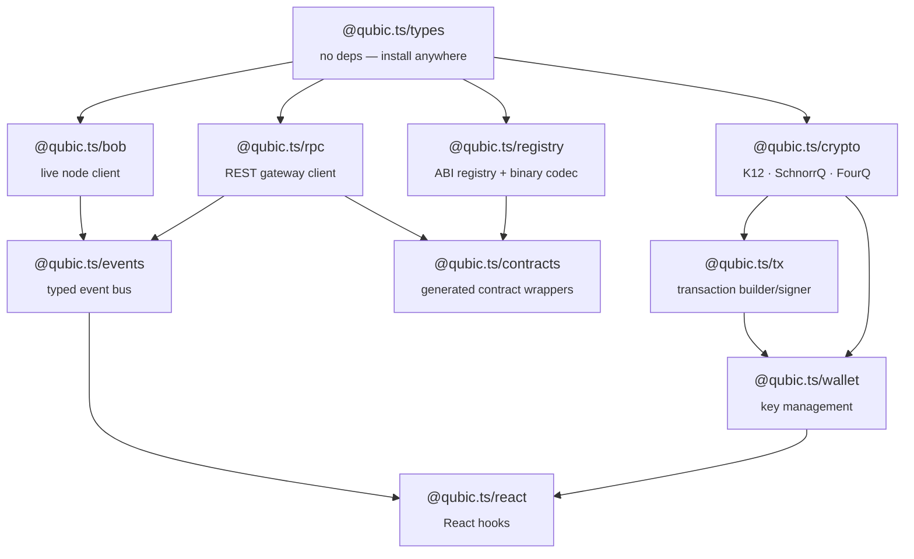
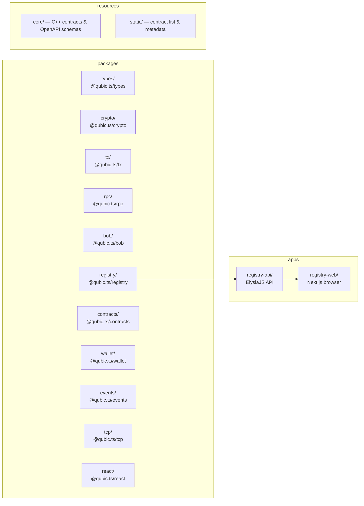

# qubic-typescript

TypeScript SDK for the [Qubic](https://qubic.org) network. Modular, tree-shakeable packages covering cryptography, transaction building, RPC access, smart contract ABI encoding/decoding, and live node subscriptions. Built for [Bun](https://bun.com) with full Node.js compatibility.

## Packages

| Package | Version | Description |
|---|---|---|
| [`@qubic.ts/types`](packages/types) | 0.1.0 | Branded primitives, protocol constants, shared error types |
| [`@qubic.ts/crypto`](packages/crypto) | 0.1.0 | K12 hash, SchnorrQ signatures, FourQ key derivation |
| [`@qubic.ts/tx`](packages/tx) | 0.1.0 | Binary transaction builder, signer, and verifier |
| [`@qubic.ts/rpc`](packages/rpc) | 0.1.0 | Type-safe REST client for the Qubic RPC gateway |
| [`@qubic.ts/bob`](packages/bob) | 0.1.0 | Live node client — JSON-RPC 2.0, REST, WebSocket subscriptions |
| [`@qubic.ts/registry`](packages/registry) | 0.1.0 | Versioned ABI registry for all Qubic smart contracts across all epochs |
| [`@qubic.ts/contracts`](packages/contracts) | 0.1.0 | Generated typed wrappers for every deployed contract |
| [`@qubic.ts/events`](packages/events) | 0.0.0 | Typed event bus |
| [`@qubic.ts/wallet`](packages/wallet) | 0.1.0 | Wallet, encrypted vault, and seed utilities |
| [`@qubic.ts/tcp`](packages/tcp) | 0.0.0 | Raw TCP transport for peer connections |
| [`@qubic.ts/react`](packages/react) | 0.0.0 | React hooks and context providers |

## Quick start

```bash
bun install
bun test          # run all tests
bun run typecheck # typecheck all packages
bun run build     # build all packages
bun run lint      # lint + format (biome)
```

## Package dependency graph



## End-to-end example: wallet transfer

```ts
import { generateSeed, createWallet, createVault, unlockVault } from '@qubic.ts/wallet'
import { createLiveClient } from '@qubic.ts/rpc'
import type { Identity } from '@qubic.ts/types'

const live = createLiveClient()
const { tickInfo } = await live.getTickInfo()

// Generate and persist a seed in an encrypted vault
const seed = generateSeed()
const vault = await createVault('strong-password', [seed])
// exportVault(vault) → persist JSON to disk / localStorage

// Later: unlock and use
const [storedSeed] = await unlockVault(vault, 'strong-password')
const wallet = createWallet(storedSeed)

console.log(wallet.identity) // 60-char Qubic identity

const { encoded } = await wallet.buildTransfer({
  destination: 'BZBQFLLBNCXEMGLOBHUVGPQVZEJYLR...' as Identity,
  amount: 1_000_000n,
  targetTick: tickInfo.tick + 5,
  currentTick: tickInfo.tick,
})

const result = await live.broadcastTransaction(encoded)
console.log('peers:', result.peersBroadcastedTo)
```

## End-to-end example: build and broadcast a contract call

```ts
import { createWallet, toSeed } from '@qubic.ts/wallet'
import { createLiveClient } from '@qubic.ts/rpc'
import { qearn } from '@qubic.ts/contracts'
import type { Identity } from '@qubic.ts/types'

const live = createLiveClient()
const { tickInfo } = await live.getTickInfo()
const wallet = createWallet(toSeed('yourfiftyfivecharacterlowercaseseedgoeshere1234567'))

const payload = qearn.buildLockInput({ amount: 10_000_000n })

const { encoded } = await wallet.buildScTransaction({
  destination: 'AAAAAAAAAAAAAAAAAAAAAAAAAAAAAAAAAAAAAAAAAAAAAAAAAAAAAAAAAAAA' as Identity,
  amount: 10_000_000n,
  targetTick: tickInfo.tick + 5,
  currentTick: tickInfo.tick,
  inputType: 6,
  payload,
})

const result = await live.broadcastTransaction(encoded)
console.log('peers:', result.peersBroadcastedTo)
```

## End-to-end example: query a contract read function

```ts
import { createLiveClient } from '@qubic.ts/rpc'
import { qearn } from '@qubic.ts/contracts'
import { identityToPublicKey, publicKeyToIdentity } from '@qubic.ts/crypto'

const live = createLiveClient()

const result = await qearn.getStateOfRound(live, { epoch: 212 }, {
  identityToPublicKey,
  publicKeyToIdentity,
})

if (result.ok) {
  console.log('state:', result.value.state)
} else {
  console.error('RPC error:', result.error.status, result.error.endpoint)
}
```

## End-to-end example: decode a historical transaction payload

```ts
import { createRegistryClient } from '@qubic.ts/registry/client'
import { decodePayload } from '@qubic.ts/registry'
import { publicKeyToIdentity } from '@qubic.ts/crypto'

// Get the ABI active at the epoch when the tx was submitted
const registry = createRegistryClient()
const { version } = await registry.getAbi(9 /* Qearn */, 180 /* epoch */)

const lockProc = version.procedures.find(p => p.name === 'lock_input')!
const decoded = decodePayload(payloadBytes, lockProc.inputFields, version.structs, publicKeyToIdentity)
// decoded.amount, decoded.numberOfEpochs, etc.
```

## Contract ABI registry

`@qubic.ts/registry` stores per-epoch ABI snapshots as JSON for every Qubic smart contract. Each snapshot records the exact binary field layout (`inputFields`, `outputFields`, nested structs) active in that epoch. The codec engine (`buildPayload` / `decodePayload`) handles all Qubic primitive types including `uint128` and FourQ identity fields.

**Coverage**: epochs 122–212 (all epochs with deployed contracts since early mainnet)

```
packages/registry/data/
  epochs/
    122/  Quottery.json  Qx.json  ...
    ...
    212/  (27 contracts)
  epoch-refs.json   — epoch → git tag map
  registry.json     — compiled version-range index
```

To regenerate snapshots from source:

```bash
# Parse ABI from qubic/core git tags (requires GitHub access)
bun run packages/registry/scripts/backfill.ts --from-epoch 200

# Regenerate TypeScript wrappers from latest snapshot
bun run packages/contracts/scripts/generate.ts
```

## Contract wrappers

`@qubic.ts/contracts` provides fully typed wrappers generated from the latest epoch snapshot. Every contract exports:

- **Constants**: `CONTRACT_INDEX`, per-procedure `INPUT_TYPE` constants
- **Payload builders**: `build{Contract}{Procedure}Input(input) → Uint8Array` — for use in transaction construction
- **Output decoders**: `decode{Contract}{Procedure}Output(data) → Output` — for decoding SC responses
- **Async callers**: `{contract}{Function}(live, input?, options?) → Promise<Result<Output, QubicRpcError>>` — for read-only queries
- **Namespace object**: `export const {contract} = { contractIndex, ...callers, ...builders, ...decoders }`

```ts
import { qearn, qx, quottery } from '@qubic.ts/contracts'

// Read-only query
const state = await qearn.getStateOfRound(live, { epoch: 212 })

// Payload builder (for transaction construction)
const payload = qx.buildAddToAskOrderInput({
  assetName: 'CFB',
  issuer: 'CFBMEMZOIDEXQAUXYYSZIURADQLAPWPMNJXQSNVQZAHYVOPYUKKJBJUCTVJL',
  price: 500n,
  numberOfShares: 10n,
})
```

## Monorepo structure



## Tooling

- **Runtime**: [Bun](https://bun.com) v1.3+
- **Formatter/linter**: [Biome](https://biomejs.dev) — run `bun run lint`
- **Type checker**: TypeScript 5.7+ — run `bun run typecheck`
- **Test runner**: `bun test` (built-in)
- **Docs**: [TypeDoc](https://typedoc.org) — `bunx typedoc`
- **Releases**: [Changesets](https://github.com/changesets/changesets) — `bun run changeset`
- **Commit format**: Conventional commits enforced by commitlint
