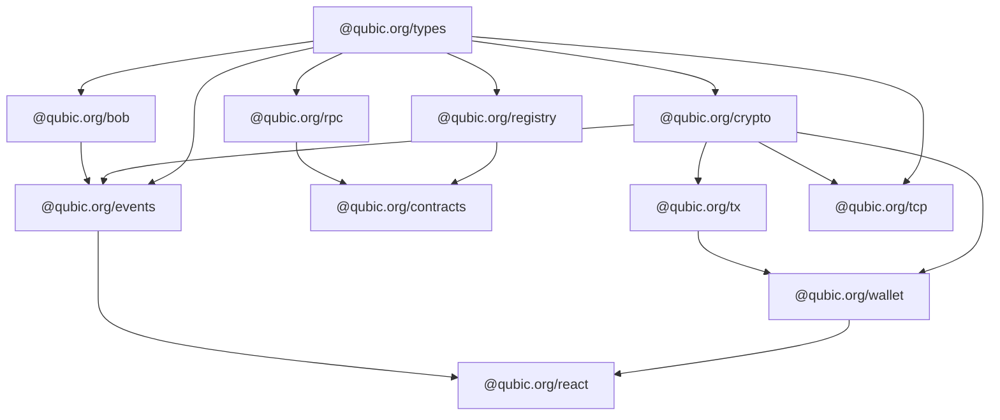

The Qubic TypeScript SDK is a collection of focused packages that cover everything from raw cryptography to React hooks. You pick what you need; the packages are independently installable and tree-shakeable.

Built for [Bun](https://bun.sh). Works with Node.js.

## Packages

| Package | Description |
|---|---|
| [`@qubic.org/types`](/docs/packages/types) | Branded primitives, protocol constants, shared error types |
| [`@qubic.org/crypto`](/docs/packages/crypto) | K12 hash, SchnorrQ signatures, FourQ key derivation |
| [`@qubic.org/tx`](/docs/packages/tx) | Binary transaction builder, signer, and verifier |
| [`@qubic.org/wallet`](/docs/packages/wallet) | Wallet, encrypted vault, and seed utilities |
| [`@qubic.org/rpc`](/docs/packages/rpc) | Type-safe REST client for the Qubic RPC gateway |
| [`@qubic.org/bob`](/docs/packages/bob) | Live node client — JSON-RPC 2.0, REST, WebSocket subscriptions |
| [`@qubic.org/events`](/docs/packages/events) | Binary event decoder, filter builder, typed Bob subscription helpers |
| [`@qubic.org/registry`](/docs/packages/registry) | Versioned ABI registry for all Qubic smart contracts across all epochs |
| [`@qubic.org/contracts`](/docs/packages/contracts) | Generated typed wrappers for every deployed contract |
| [`@qubic.org/tcp`](/docs/packages/tcp) | Direct TCP transport — framing, connection pool, typed request helpers |
| [`@qubic.org/react`](/docs/packages/react) | React hooks and providers — TanStack Query, VaultProvider, wallet connectors |

## Where to start

<Cards>
  <Card title="Getting started" href="/docs/getting-started">
    Send your first transaction in under 5 minutes.
  </Card>
  <Card title="React dApp" href="/docs/guides/react-dapp">
    Build a browser wallet with hooks and wallet connectors.
  </Card>
  <Card title="Contract queries" href="/docs/guides/contract-query">
    Read data from any deployed Qubic smart contract.
  </Card>
  <Card title="Live events" href="/docs/guides/live-events">
    Subscribe to transfers and contract logs over WebSocket.
  </Card>
</Cards>

## Package dependency graph

`@qubic.org/types` has no dependencies and can be installed anywhere. Every other package depends on it.
