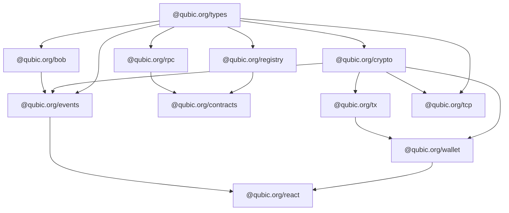

The Qubic TypeScript SDK is a collection of focused packages that cover everything from raw cryptography to React hooks. You pick what you need; the packages are independently installable and tree-shakeable.

Built for [Bun](https://bun.sh). Works with Node.js.

## Packages

<PackageList />

## Where to start

<Cards>
  <Card title="Getting started" href="/getting-started">
    Send your first transaction in under 5 minutes.
  </Card>
  <Card title="React dApp" href="/guides/react-dapp">
    Build a browser wallet with hooks and wallet connectors.
  </Card>
  <Card title="Contract queries" href="/guides/contract-query">
    Read data from any deployed Qubic smart contract.
  </Card>
  <Card title="Live events" href="/guides/live-events">
    Subscribe to transfers and contract logs over WebSocket.
  </Card>
</Cards>

## Package dependency graph

`@qubic.org/types` has no dependencies and can be installed anywhere. Every other package depends on it.
