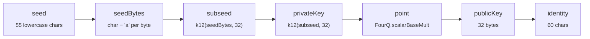

# `@qubic.org/crypto`

Qubic cryptographic primitives: KangarooTwelve hashing, FourQ elliptic curve arithmetic, SchnorrQ signatures, and seed/identity derivation.

This package implements the full Qubic cryptographic stack in pure TypeScript, without native addons. It is a direct port of the Go and C++ reference implementations used by the Qubic network. `@qubic.org/tx` depends on this package to sign and hash transactions.

## Installation

```sh
bun add @qubic.org/crypto
```

Dependencies: `@noble/hashes`, `@qubic.org/types`

## API

### Hashing

```ts
function k12(data: Uint8Array, outputLength?: number): Uint8Array
```

Computes a KangarooTwelve (KT128) hash of arbitrary length. Defaults to 32 bytes. Backed by `@noble/hashes`'s audited `kt128` implementation. Qubic uses K12 everywhere SHA-256 would appear in Bitcoin-style systems.

### Seed and key derivation

```ts
function generateRandomSeed(): Seed
```

Generates a cryptographically secure random 55-character lowercase seed using `globalThis.crypto.getRandomValues`. Returns a branded `Seed`.

```ts
function publicKeyFromSeed(seed: Seed): Uint8Array
```

Derives the 32-byte compressed FourQ public key from a seed. Equivalent to running the full key derivation pipeline without returning intermediate values.

```ts
function deriveIdentityFromSeed(seed: Seed): Identity
```

Derives the 60-character uppercase Qubic identity string from a seed. This is the primary function for turning a seed into an address.

### Identity / public key encoding

```ts
function publicKeyToIdentity(publicKey: Uint8Array): Identity
```

Encodes a 32-byte compressed FourQ public key into the 60-character uppercase Qubic identity format. The encoding splits the key into four 64-bit little-endian fragments, converts each digit to base-26, then appends a 4-character checksum computed via `k12(publicKey, 3)`.

```ts
function identityToPublicKey(identity: Identity): Uint8Array
function isValidIdentityChecksum(identity: string): identity is Identity
```

Decodes a 60-character identity back to its 32-byte public key. Validates the 4-character checksum and throws `InvalidIdentityError` if it does not match.

`isValidIdentityChecksum` exposes the same checksum validation as a non-throwing type guard for callers that need full identity validation while `@qubic.org/types` remains structurally branded.

### Signing and verification

```ts
function sign(message: Uint8Array, seed: Seed): Promise<Uint8Array>
```

Signs a message digest using SchnorrQ over the FourQ elliptic curve. Internally runs key derivation to obtain the subseed and public key, then executes the SchnorrQ signing protocol. Returns a 64-byte signature (`R || s`). The `message` parameter is typically a 32-byte K12 digest computed by `@qubic.org/tx` — it is not automatically hashed here.

```ts
function verify(message: Uint8Array, signature: Uint8Array, publicKey: Uint8Array): boolean
```

Verifies a SchnorrQ signature. Returns `true` if valid, `false` otherwise. Does not throw on invalid input — malformed signatures produce `false`.

### Randomness

```ts
function getRandomBytes(n: number): Uint8Array
```

Returns `n` cryptographically secure random bytes from `globalThis.crypto.getRandomValues`. Throws `RangeError` if `n <= 0`.

## Error handling

```ts
class InvalidSeedError    extends QubicError  // code: 'INVALID_SEED'
class InvalidIdentityError extends QubicError // code: 'INVALID_IDENTITY'
```

`deriveIdentityFromSeed`, `publicKeyFromSeed`, and `sign` throw `InvalidSeedError` if the seed is not exactly 55 lowercase ASCII letters. `identityToPublicKey` throws `InvalidIdentityError` if the identity is malformed or the checksum fails.

## Examples

### Generate a fresh wallet

```ts
import { generateRandomSeed, deriveIdentityFromSeed } from '@qubic.org/crypto'

const seed = generateRandomSeed()
const identity = deriveIdentityFromSeed(seed)

console.log('Seed:    ', seed)      // 55 lowercase letters
console.log('Address: ', identity)  // 60 uppercase letters
```

### Sign arbitrary data

```ts
import { k12, sign, verify, publicKeyFromSeed } from '@qubic.org/crypto'
import { toSeed } from '@qubic.org/types'

const seed = toSeed('aaaaaaaaaaaaaaaaaaaaaaaaaaaaaaaaaaaaaaaaaaaaaaaaaaaaaaa')
const message = new TextEncoder().encode('hello qubic')
const digest = k12(message, 32)

const signature = await sign(digest, seed)
const publicKey = publicKeyFromSeed(seed)

const valid = verify(digest, signature, publicKey)
console.log('Signature valid:', valid)  // true
```

### Validate an identity checksum

```ts
import { deriveIdentityFromSeed, isValidIdentityChecksum } from '@qubic.org/crypto'
import { toSeed } from '@qubic.org/types'

const seed = toSeed('aaaaaaaaaaaaaaaaaaaaaaaaaaaaaaaaaaaaaaaaaaaaaaaaaaaaaaa')
const identity = deriveIdentityFromSeed(seed)

console.log(isValidIdentityChecksum(identity)) // true
console.log(isValidIdentityChecksum(identity.slice(0, 56) + 'AAAA')) // false
```

### Decode an identity to its public key

```ts
import { deriveIdentityFromSeed, identityToPublicKey, publicKeyToIdentity } from '@qubic.org/crypto'
import { toSeed } from '@qubic.org/types'

const seed = toSeed('aaaaaaaaaaaaaaaaaaaaaaaaaaaaaaaaaaaaaaaaaaaaaaaaaaaaaaa')
const identity = deriveIdentityFromSeed(seed)
const publicKey = identityToPublicKey(identity)
console.log('Public key bytes:', publicKey)  // Uint8Array(32)

// Round-trip
const roundTripped = publicKeyToIdentity(publicKey)
console.log('Round-trip match:', roundTripped === identity)  // true
```

### Hash data with K12

```ts
import { k12 } from '@qubic.org/crypto'

const data = new Uint8Array([1, 2, 3, 4])
const digest32 = k12(data, 32)
const digest64 = k12(data, 64)
console.log('32-byte digest:', digest32)
console.log('64-byte digest:', digest64)
```

## Design notes

**Why KangarooTwelve instead of SHA-256 or Keccak-256?** K12 is the XOF (extendable-output function) used throughout the Qubic protocol. It has variable output length, which the Qubic identity encoding and SchnorrQ signing both rely on. Using any other hash would produce incompatible addresses and signatures.

**Why SchnorrQ over Ed25519 or ECDSA?** Qubic chose SchnorrQ on the FourQ curve for its small key/signature sizes and performance characteristics on constrained hardware. FourQ supports constant-time scalar multiplication which is important for a blockchain's security model. This package ports the reference implementation faithfully to ensure compatibility with on-chain signature verification.

**Why is `sign` async?** The `async` marker is intentional forward-compatibility: future runtime targets (e.g. browser WebCrypto, hardware security modules) may provide native SchnorrQ primitives via a `Promise`-based API. The current implementation resolves synchronously.

**Key derivation pipeline:**


