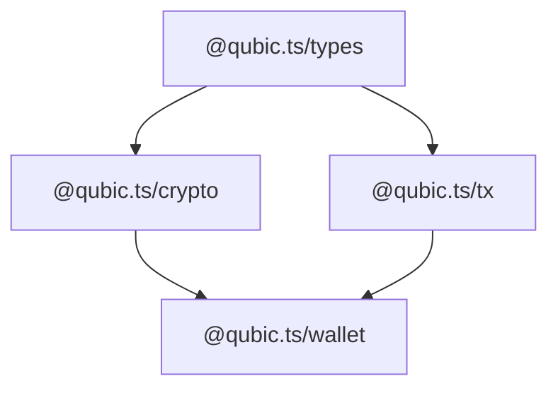

# @qubic.ts/wallet

Wallet and key management for the Qubic network.

> **Status**: early development — API surface will expand significantly.

## Overview

`@qubic.ts/wallet` provides higher-level key management on top of `@qubic.ts/crypto`. It abstracts seed storage, identity derivation, and transaction signing into a cohesive wallet interface.

## Installation

```bash
bun add @qubic.ts/wallet
```

## Dependencies

- `@qubic.ts/crypto` — key derivation and signing primitives
- `@qubic.ts/tx` — transaction building
- `@qubic.ts/types` — branded types

## Relationship to other packages



The wallet layer consumes `@qubic.ts/crypto` for key operations and `@qubic.ts/tx` for constructing transactions, providing a unified interface for application code.

## See also

- [`@qubic.ts/crypto`](../crypto) — raw cryptographic primitives (K12, SchnorrQ, identity derivation)
- [`@qubic.ts/tx`](../tx) — transaction builder and signer
- [`@qubic.ts/react`](../react) — React hooks that wrap this package
